<div align="center">

# EVIDENT: Routing MLLM Adaptation through Entity-Grounded Visual Evidence for Cross-Domain Video Temporal Grounding

[](https://arxiv.org/abs/2605.26104)
[](https://arxiv.org/abs/2605.26104)
[](LICENSE)
[](https://github.com/KHU-VLL/EVIDENT)

[Geo Ahn](https://ahngeo.github.io/)<sup>1*</sup>,
[Jiwook Han](https://mreraser.github.io/)<sup>1*</sup>,
[Youngrae Kim](https://youngraekimm.github.io/)<sup>2*</sup>,
[Joonseok Lee](http://www.joonseok.net/home.html)<sup>3</sup>,
[Jinwoo Choi](https://sites.google.com/site/jchoivision/)<sup>1†</sup>

<sup>1</sup>**Kyung Hee University** &nbsp; <sup>2</sup>**University of Southern California** &nbsp; <sup>3</sup>**Seoul National University**

<sup>*</sup>Equal contribution &nbsp; <sup>†</sup>Corresponding author

**NeurIPS 2026**

<a href="assets/teaser.svg"></a>

</div>

## Overview

Fine-tuned MLLMs ground queries in time well on their training domain but break down under domain shift. We trace this mainly to *visual* domain shift, which keeps the model from tying the localization skill it learned to the entity attention it already has. **EVIDENT** is a parameter-efficient framework that routes adaptation through explicit visual entities:

| Component | What it does | Code |
|:-:|---|---|
| **Entity Bottleneck (EB) Adapter** | Compresses the visual tokens of each frame into a few entity slots with slot attention and reconstructs the tokens from them | [`eb_adapter.py`](evident/model/eb_adapter.py) |
| **Entity-Binding Distillation (EBD)** | Binds each slot to a coherent entity using DINOv2 objectness priors (k-means + Hungarian matching) | [`ebd_loss.py`](evident/losses/ebd_loss.py) |
| **Entity-to-eVidence (E2V) Gating** | Weights each frame by how strongly it contains the subject and object of the query | [`eb_adapter.py`](evident/model/eb_adapter.py) |

EVIDENT improves out-of-domain grounding across Charades-STA, QVHighlights and DiDeMo while staying competitive in-domain, training only ~2.4% of the parameters of Qwen2.5-VL-7B.

## 🤗 Model Zoo

Checkpoints are hosted at [mreraser/EVIDENT](https://huggingface.co/mreraser/EVIDENT) and are downloaded automatically by `load_evident` / `evaluate.py`.

| Source | Checkpoint | → Charades-STA | → QVHighlights | → DiDeMo |
|---|---|:-:|:-:|:-:|
| Charades-STA | [`charades`](https://huggingface.co/mreraser/EVIDENT/tree/main/charades) | 69.1 / 59.9 | 59.8 / 55.2 | 55.4 / 48.5 |
| QVHighlights | [`qvhighlights`](https://huggingface.co/mreraser/EVIDENT/tree/main/qvhighlights) | 50.2 / 49.0 | 82.2 / 75.3 | 36.0 / 40.6 |

Numbers are R1@0.5 / mIoU from Table 1 of the paper.

## 🔧 Installation

```bash
conda create -n evident python=3.11 -y
conda activate evident
git clone https://github.com/KHU-VLL/EVIDENT.git && cd EVIDENT
pip install -r requirements.txt
```

## 📦 Data Preparation

**Videos.** Download [Charades-STA](https://prior.allenai.org/projects/charades), [QVHighlights](https://github.com/jayleicn/moment_detr) and [DiDeMo](https://github.com/LisaAnne/LocalizingMoments).

**Annotations.** [`data/annotations/`](data/annotations) provides all train/test splits with the subject/object concepts used by E2V gating (extracted with Qwen3-4B-Instruct-2507):

```json
{
  "video": "AO8RW.mp4",
  "conversations": [
    {"from": "human", "value": "<video>\nThe video lasts 33.67 seconds.\nQuery: a person is putting a book on a shelf.\nGiven the video and the query, find the relevant windows [start_time, end_time]."},
    {"from": "gpt", "value": "[[0.0, 6.9]]"}
  ],
  "key_concepts": ["subject: person", "object: book"]
}
```

<details>
<summary>Extracting concepts for a new dataset</summary>

```bash
torchrun --nproc_per_node=4 tools/extract_key_concepts.py --input my_train.json --output my_train_with_concepts.json
```
</details>

**DINOv2 features (for EBD).** Extract once per training set, with the same number of frames as training:

```bash
python tools/extract_dino_features.py --annotation data/annotations/charades_train.json \
    --video_dir $CHARADES_VIDEOS --output_dir $CHARADES_DINO --num_frames 20
python tools/extract_dino_features.py --annotation data/annotations/qvhighlights_train.json \
    --video_dir $QVH_VIDEOS --output_dir $QVH_DINO --num_frames 60
```

## 🚀 Training

```bash
VIDEO_DIR=$CHARADES_VIDEOS DINO_DIR=$CHARADES_DINO bash scripts/train_charades.sh      # 20 frames
VIDEO_DIR=$QVH_VIDEOS      DINO_DIR=$QVH_DINO      bash scripts/train_qvhighlights.sh  # 60 frames
```

| Setting | Value |
|---|---|
| Backbone | Qwen2.5-VL-7B-Instruct (vision encoder and LLM frozen) |
| EB Adapter | decoder layers 0–10, d = 896, K = 4 slots, 3 iterations |
| EBD loss weight λ | 0.1 (Charades-STA), 1.0 (QVHighlights) |
| LoRA | decoder layers 11–27, r = 16, α = 64 |
| Frames | 224×224 (64 tokens each), 20 for Charades-STA, 60 for QVHighlights |
| Timestamps | Charades-STA: relative integers in [0, 100]; QVHighlights: integer seconds |
| Optimization | AdamW, lr 5e-5, wd 0.1, cosine schedule over 5 epochs with 5% warmup, stopped after 2 epochs |
| Batch | 32 (8 GPUs × 1 × 4 accumulation steps) |

Each checkpoint holds the LoRA weights (`adapter_model.safetensors`), the EB Adapter weights (`eb_adapter.safetensors`) and the adapter configuration (`evident_config.json`, including the timestamp format, which `evaluate.py` reads automatically).

## 📊 Evaluation

Evaluate on Charades-STA (20 frames), QVHighlights (60 frames) and DiDeMo (20 frames):

```bash
CHARADES_VIDEOS=... QVH_VIDEOS=... DIDEMO_VIDEOS=... \
    bash scripts/eval_cross_domain.sh checkpoints/evident_charades
```

To evaluate a released checkpoint, pass `--checkpoint mreraser/EVIDENT --subfolder charades` (or `qvhighlights`). For a single benchmark:

```bash
torchrun --nproc_per_node=8 evaluate.py --checkpoint checkpoints/evident_charades \
    --annotation data/annotations/qvhighlights_test.json --video_dir $QVH_VIDEOS \
    --num_frames 60 --output results/cha2qvh.json
```

We report R1@{0.3, 0.5, 0.7} and mIoU, scoring the first predicted window against the best-matching ground-truth window.

### Loading a trained model

```python
from evident.model import load_evident

model = load_evident("mreraser/EVIDENT", subfolder="charades")   # released checkpoint
model = load_evident("checkpoints/evident_charades")               # your own checkpoint
```

See `predict()` in [`evaluate.py`](evaluate.py) for prompt construction and decoding.

## 🗂️ Repository Structure

```
evident/
├── model/      EB Adapter, slot attention, E2V gating, injection into Qwen2.5-VL, checkpoint loading
├── losses/     Entity-Binding Distillation loss
├── data/       video loading, prompt construction, dataset and collator
└── train/      arguments and trainer (L = L_CE + λ·L_EBD)
tools/          DINOv2 feature and concept extraction
scripts/        training and evaluation launchers
```

## 📄 License

This project is released under the [Apache 2.0 License](LICENSE).

## 🙏 Acknowledgements

- [Qwen2-VL-Finetune](https://github.com/2U1/Qwen2-VL-Finetune): the training pipeline started from this codebase.
- [Qwen2.5-VL](https://github.com/QwenLM/Qwen2.5-VL): backbone MLLM.
- [DINOv2](https://github.com/facebookresearch/dinov2): objectness priors for Entity-Binding Distillation.
- [Chrono](https://github.com/sudo-Boris/mr-Blip): relative timestamp format.

## 📝 Citation

```bibtex
@inproceedings{ahn2026evident,
  title     = {EVIDENT: Routing MLLM Adaptation through Entity-Grounded Visual Evidence for Cross-Domain Video Temporal Grounding},
  author    = {Ahn, Geo and Han, Jiwook and Kim, Youngrae and Lee, Joonseok and Choi, Jinwoo},
  booktitle = {NeurIPS},
  year      = {2026}
}
```
